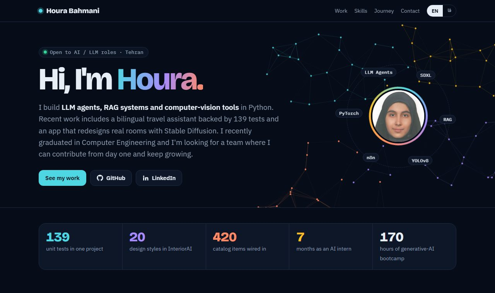

# Houra Bahmani Qajar — Portfolio

**Live site: [h-bahmani.github.io](https://h-bahmani.github.io)**

[](https://h-bahmani.github.io)

Personal portfolio of Houra Bahmani Qajar, an AI engineer working on LLM agents, retrieval-augmented generation (RAG) and computer vision. The site is bilingual (English / Persian) and switches to a full right-to-left layout in Persian.

## What's on the site

- **How I build** — an animated diagram of the RAG agent pipeline used in most of my LLM work: question → embedding → retrieval → reranking → LLM agent with citations and tool calls.
- **Selected projects**, each with its own visual:
  - [Safar Travel AI](https://github.com/h-bahmani/Safar-Travel-AI) — bilingual travel-booking agent with tool calling, RAG and 139 unit tests.
  - [Persian RAG & Telegram assistant](https://github.com/h-bahmani/pydanticai_RAG) — Persian knowledge-base Q&A and an n8n voice booking bot.
  - [InteriorAI](https://github.com/h-bahmani/interior-design) — room redesign with Stable Diffusion and ControlNet, shown with real before/after outputs.
  - [Watermark detection & removal](https://github.com/h-bahmani/watermark-project) — YOLOv8n / SLBR detection with LaMa inpainting, evaluated with PSNR, SSIM and IoU.
- **Skill map** — an interactive map that links each tool to the projects where it was used.
- **Journey** — a timeline from 2022 to 2026.
- **Education & courses** — B.Sc. in Computer Engineering (GPA 18.77) and course hours as a bar chart.
- **Ask my portfolio** — a small BM25-style keyword search that runs in the browser over the page's own content and cites its results.

## Tech

A single static `index.html`: plain HTML, CSS and JavaScript, with no framework and no build step. Images are embedded in the page, and fonts load from Google Fonts. Light and dark themes follow the visitor's system setting, and animations respect `prefers-reduced-motion`.

## Run locally

Open `index.html` in a browser, or serve the folder:

```bash
python -m http.server 8000
```

Then visit `http://localhost:8000`.

## Contact

- Email: h.bahmani2023@gmail.com
- LinkedIn: [linkedin.com/in/houra-bahmani](https://www.linkedin.com/in/houra-bahmani)
- GitHub: [github.com/h-bahmani](https://github.com/h-bahmani)
